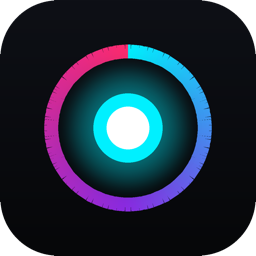

<p align="center">
  
</p>

<h1 align="center">AURA REC</h1>

<p align="center">
  免費、開源、隱私優先的螢幕錄影與教學剪輯工具。<br>
  macOS ＋ Windows 桌面版，另有免安裝的瀏覽器版。錄影內容全程留在你的電腦，不上傳。
</p>

<p align="center">
  <a href="https://github.com/malilion/Record/releases/latest"><b>下載桌面版</b></a> ·
  <a href="https://malilion.github.io/Record/download/AURA-REC.html"><b>直接開網頁版</b></a> ·
  <a href="https://malilion.github.io/Record/">官方網站</a> ·
  <a href="docs/DEVELOPMENT.md">開發與打包</a>
</p>

---

## 它是做什麼的

AURA REC 把「錄」和「剪」放在同一個工具：錄下螢幕、麥克風與電腦聲音，錄的過程中就能畫重點、打聚光燈，錄完直接在內建工作站裁切、加字幕、遮住敏感資訊後匯出。適合做教學影片、產品展示、簡報錄影與遠端說明。

## 功能

### 錄影
- **錄哪裡**：整個螢幕、自訂範圍，或單一視窗（檔名自動帶程式名稱）；支援多螢幕。
- **畫質與流暢度**：原生、2K、1080p、720p；15 / 30 / 60 / 120 FPS。macOS 用 VideoToolbox，Windows 用 NVENC / QSV / AMF，沒有可用的 GPU 編碼器時自動退回軟體編碼。
- **聲音**：麥克風與系統聲音可存成**獨立兩條音軌**，後製分別調整人聲與背景音（macOS 內錄系統聲音需先裝 BlackHole，程式內有圖文指南）。
- **長時間錄影**：直接寫入硬碟，不吃記憶體；可設定自動停止或每 5 / 10 / 30 分鐘自動分段。輸出 MP4 或 MOV。
- **畫中畫鏡頭**：圓形或圓角方形，四角可放；背景可選原始、虛化、去背、綠藍幕、極光背景。

### 錄影中的互動
- **螢幕塗鴉 `F6`**：畫筆、箭頭、方框、聚光燈，5 色、3 種粗細、可復原。
- **點擊波紋與按鍵顯示**：滑鼠點擊產生水波紋，按下的鍵（含 ⌘⌥⌃⇧ 組合）浮現在畫面下方。
- **控制列不入鏡**：錄影控制列對錄影畫面隱形，你看得到、錄不到。

### 隱私保護
- **敏感視窗自動遮蔽**：偵測密碼管理器、通訊軟體、無痕視窗、網路銀行等，錄影中自動模糊、馬賽克或遮蔽。
- **局部遮罩**：在剪輯畫面上框選 API Key、密碼等資訊，套用模糊或馬賽克（全片或指定區段）。
- **標示浮水印**：角落簽名、時間戳、動態漂浮、滿版網格等模式，用來標示來源。
- ⚠️ 視窗隱藏與敏感視窗遮蔽是盡力而為，擋不了 HDMI 擷取卡或手機翻拍；浮水印是可見標示，可被裁切或重新編碼移除，**不等於防盜**。

### 剪輯工作站
- **膠卷時間軸**：滑鼠滑過即時預覽，拖曳起點／終點握把；下方有音訊波形，一眼找出停頓與贅詞。
- **0.5 秒智慧無損裁切**：只重新編碼頭尾，中間原封不動複製，畫質不損失、速度極快，多音軌完整保留。
- **自動運鏡 (Auto Zoom)**：平滑推進特寫，可手動指定焦點或自動偵測畫面動態中心。
- **AI 離線字幕**：使用本機 Whisper（需自行安裝 `whisper-cli` 與模型）或內建的語音活動偵測分句；可就地編輯，匯入匯出 SRT / VTT，或封裝成軟字幕。
- **其他**：濾鏡與倍速、直式 9:16 模糊補位、高畫質 GIF 匯出。

### 介面
繁體中文、English、日本語、简体中文，免重啟即時切換，並會依系統語言自動選擇。內建自動檢查更新（讀取 GitHub Releases）。

## 桌面版與網頁版怎麼選

| | 桌面版 | 網頁版 |
| --- | --- | --- |
| 安裝 | 下載安裝 | 不用安裝，開瀏覽器或雙擊單一檔案 |
| 錄影編碼 | GPU 硬體編碼，適合長時間、4K、高幀率 | 瀏覽器內建錄製，適合短片與快速試用 |
| 電腦系統聲音 | 可（macOS 需 BlackHole） | 看瀏覽器：Chrome / Edge 可，Safari / Firefox 不支援，會自動改為純畫面 |
| 指定視窗、自動遮蔽敏感視窗、AI 字幕 | ✅ | — |
| 錄影中塗鴉與聚光燈 | ✅（`F6`，全螢幕） | ✅（畫在預覽上） |
| 匯出 | 無損裁切、GIF、字幕 | 霓虹外框 MP4（含漸層壁紙與視窗框）、WebM、WAV、PNG |
| 網路 | 只在檢查更新時連 GitHub | 單檔內嵌所有資源，**完全離線可用** |

## 安裝

### 桌面版

1. 到 [Releases](https://github.com/malilion/Record/releases/latest) 下載（已內含 Python 與 Tk，**不需另外安裝 Python**）：
   - **macOS（僅支援 Apple 晶片：M1 / M2 / M3 / M4…，macOS 11 以上；不支援 Intel Mac）**：`AURA-REC-macOS.dmg`（拖進「應用程式」）或 `.zip`
   - **Windows（64 位元）**：`AURA-REC-Setup.exe`（安裝程式，**不需要系統管理員權限**）或 `AURA-REC-Windows-x64.zip`（解壓即用）
2. **FFmpeg 已內附**，macOS 與 Windows 都不需要另外安裝。
3. 第一次開啟：
   - **macOS**：目前尚未通過 Apple 公證，系統會顯示「Apple 無法驗證『AURA REC』是否為惡意軟體」。**請按「完成」（不要丟到垃圾桶）**，然後在終端機執行下面這行，一次放行整個 app（包含內附的 ffmpeg），再重新開啟：

     ```bash
     xattr -dr com.apple.quarantine "/Applications/AURA REC.app"
     ```

     （只在「系統設定 → 隱私權與安全性 → 強制打開」放行主程式的話，內附的 ffmpeg 第一次被呼叫時可能再被擋一次，視窗就不會出現。）
     接著依序允許 **螢幕錄製**、**麥克風**（以及選用的相機、輔助使用）。
     ⚠️ 因為是 ad-hoc 簽章，**每次更新或換一份新下載的 app，系統都會把它當成新的 app，需要重新授權**；建議固定只用 `/Applications` 裡的那一份。
   - **Windows**：若跳出 SmartScreen，按「其他資訊 → 仍要執行」。
4. 想驗證檔案完整性，可對照 Release 內的 `SHA256SUMS.txt`。

### 需要系統管理員權限嗎？

**不需要。** 程式以一般使用者身分執行，從不要求 `sudo` 或「以系統管理員身分執行」。

- **Windows**：安裝程式預設安裝到你的使用者資料夾，不跳 UAC；`.zip` 解壓即用。安裝時可自行選擇「為所有使用者安裝」（這時才會要求管理員）。
- **macOS**：把 app 拖進「應用程式」即可（若你的帳號是一般使用者，系統可能要求輸入密碼，也可放在 `~/Applications`）。系統會依功能詢問**一般的隱私權限**，由你在「系統設定 → 隱私權與安全性」同意：
  - 螢幕錄製（錄影必要）、麥克風（收音）、相機（畫中畫鏡頭）
  - 輔助使用／輸入監控（**選用**，只有「點擊發光波紋」和「按鍵顯示」需要；不開也能錄影）

### 網頁版

打開 <https://malilion.github.io/Record/download/AURA-REC.html>，或從 Release／官網下載 `AURA-REC.html` 後雙擊。請使用 Chrome、Edge 或 Brave，並允許螢幕分享。

## 使用說明

### 錄一段影片（桌面版）

1. 開啟程式，選擇**錄影範圍**（全螢幕、自訂範圍或某個視窗）。
2. 設定畫質、幀率、音訊來源（麥克風／系統聲音），需要的話打開畫中畫鏡頭、浮水印或視窗排除。
3. 按 **開始錄影**（或 `空白鍵` / `F9`），倒數 3 秒後開始。再按一次即可取消倒數。
4. 錄的途中：`F8` 暫停／繼續、`F7` 截圖、`F6` 開啟塗鴉。
5. 按 `F9` 或空白鍵停止，檔案會存到你設定的資料夾，並**自動帶入剪輯工作站**（可在選項取消「錄完自動開啟剪輯」）。

### 剪輯與匯出

想剪輯現成的影片：按主畫面的「剪輯影片（選擇檔案）」或 `Cmd/Ctrl + O`，選一支 MP4 / MOV / MKV / WebM 即可。

1. 在剪輯工作站用滑鼠滑過時間軸預覽，拖曳左右握把（或按 `I` / `O`）設定起點與終點。
2. 需要遮住資訊：在預覽畫面框選區域，選模糊或馬賽克。需要字幕：執行語音辨識後在字幕軌上修改文字。
3. 按 `Cmd/Ctrl + E` 匯出。只裁切時走「無損裁切」，幾乎瞬間完成。

### 錄影（網頁版）

1. 按「啟動螢幕錄製」，在瀏覽器的分享視窗選畫面；要錄電腦聲音請勾選分享音訊。要錄自己的聲音，打開下方「麥克風收音」。
2. 倒數 3 秒後開始，空白鍵或「停止錄製」結束。
3. 在時間軸標好起點與終點，按「✨ 匯出霓虹外框 (MP4)」或「原始片段 (WebM)」。也可按「匯入本機影片」或直接把影片拖進視窗。
4. 「專案預設集」可把漸層壁紙、陰影、圓角與標題存成 `.auraproj`，下次直接套用。

## 快捷鍵

> `F6`–`F9` 只在 AURA REC 視窗取得焦點時有效，不是系統層級的全域快捷鍵。

| 動作 | 快捷鍵 |
| --- | --- |
| 開始／停止錄影 | `空白鍵`、`F9`、`Cmd/Ctrl + R` |
| 取消倒數 | 再按一次開始，或 `Esc` |
| 暫停／繼續 | `F8`（暫停時間不計入長度） |
| 螢幕塗鴉與聚光燈 | `F6`（塗鴉中 `1`–`4` 換工具、`Cmd/Ctrl + Z` 復原、`C` 清空、`Esc` 離開） |
| 快速截圖 | `F7` |
| 複製最新錄影檔案 | `Shift + Cmd/Ctrl + C` |
| 偏好設定 | `Cmd/Ctrl + ,` |
| 選擇影片進入剪輯 | `Cmd/Ctrl + O` |
| 剪輯：播放／暫停 | `空白鍵` |
| 剪輯：設起點／終點 | `I` / `O` |
| 剪輯：微調時間 | `←` / `→` |
| 剪輯：匯出 | `Cmd/Ctrl + E` |

## 已知限制

- macOS 版只支援 Apple 晶片（arm64），不支援 Intel Mac。
- 目前未經 Apple 公證與 Windows 程式碼簽章，首次開啟會有系統警告（見上方安裝步驟）。
- 錄影期間會要求系統不要睡眠，但**沒有斷電或當機保護**：意外斷電可能讓進行中的檔案損毀；建議長錄影開啟自動分段。
- 網頁版的「景深虛化／去背」只是羽化遮罩，不是人像分割；真正的人像去背在桌面版。
- 網頁版在 Safari 與 Firefox 無法錄系統聲音。
- 桌面版的 GPU 編碼已在 Apple Silicon 驗證；Windows 的 NVENC / QSV / AMF 尚缺真機測試回報，歡迎[提 issue](https://github.com/malilion/Record/issues)。

## 隱私

- 錄影與匯出都在本機完成，沒有任何上傳。
- 桌面版唯一的網路請求是向 `api.github.com` 檢查更新。
- 網頁版單檔已內嵌字型、樣式與函式庫；官網首頁另載入固定版本並附完整性檢查（SRI）的 CDN 腳本，頁面並設有內容安全政策（CSP）。

## 想自己打包或貢獻？

請看 [開發與打包](docs/DEVELOPMENT.md)（從原始碼執行、網頁建置、macOS 簽章與公證、專案檔案結構）。

## 授權

[MIT](LICENSE)。內附字型為 SIL OFL 授權。內附的 FFmpeg 為 GPL 授權的獨立執行檔，詳見 [第三方元件與授權](THIRD_PARTY_NOTICES.md)（含對應原始碼）。
